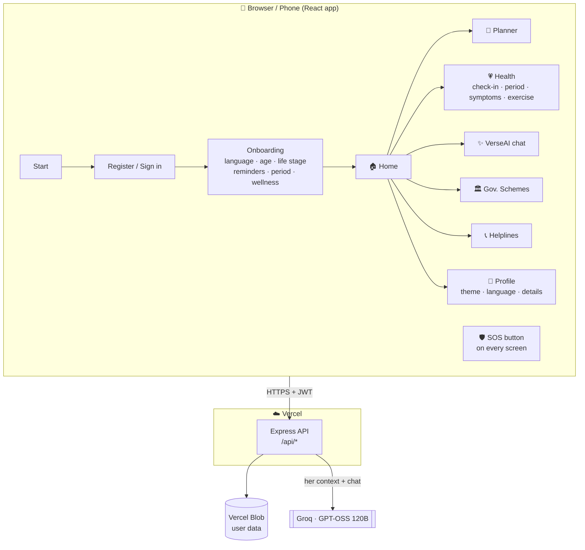
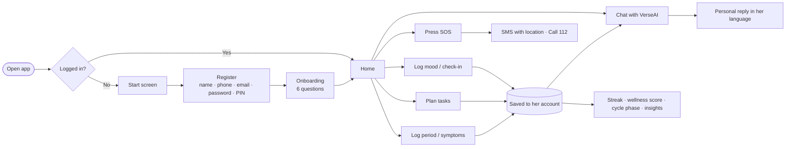
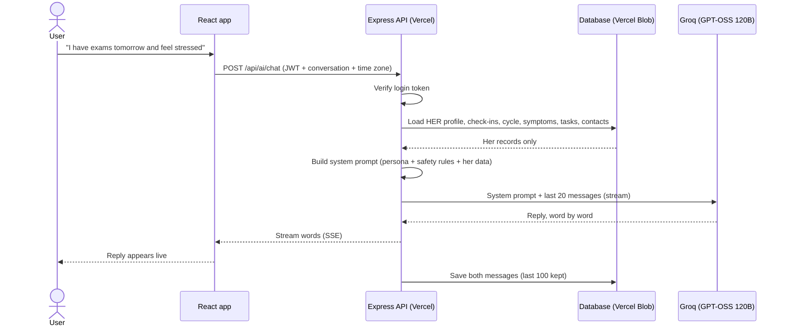
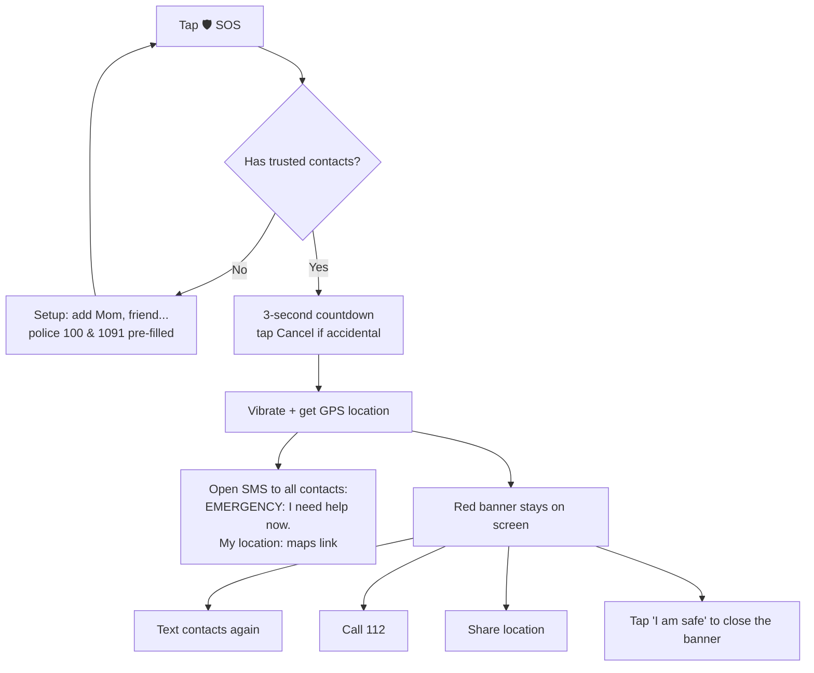
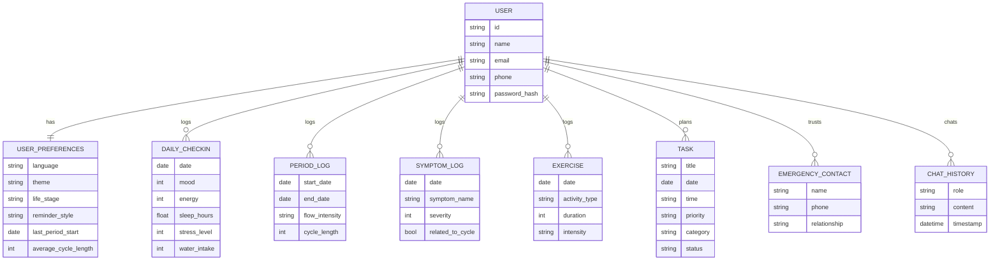

# HerVerse: every women every phase

HerVerse is a safety, health and life-planning web app for women in India. It has a planner, health and period tracking, one-tap SOS with live location, helplines, government schemes, and **VerseAI**, an AI companion that understands everything you log and replies in English, Hindi or Kannada.

> **Project review brief.** Sections 1 to 8 answer the review questions: idea, objective, audience, tech stack, team, features, workflow and expected outcome. Section 9 explains each diagram, and sections 10 to 12 cover setup, the roadmap and likely questions.

---

## 1. Project Idea (pen-and-paper design)

### Rough sketch of the main screen

```
┌──────────────────────────────────────────────┐
│ Good morning, Asha                      (A)  │  ← greeting + profile
│ How are you feeling today?                   │
├──────────────────────────────────────────────┤
│ 🕐 09:15 AM · Sunday, Nov 1             🌅   │  ← live clock
├──────────────────────────────────────────────┤
│ ✨ Daily Affirmation                          │
│ "Today is a fresh start full of possibilities"│  ← save / next
├──────────────────────────────────────────────┤
│   😢     😔     😐     😊     😄              │  ← one-tap mood
├───────────────────────┬──────────────────────┤
│ 🔥 Streak: 4 days     │ ⭕ Wellness score 80  │
├───────────────────────┴──────────────────────┤
│ Today's overview: next task · cycle phase    │
│ Health snapshot: energy · sleep · water · stress│
│ [ Daily check-in  · Log now ]                │
│ [ VerseAI ]  [ Gov. Schemes ]  [ Helplines ] │
│                                        (🛡 SOS)│ ← floating on every screen
├──────────────────────────────────────────────┤
│  Home │ Planner │ Health │ VerseAI │ Profile │  ← bottom navigation
└──────────────────────────────────────────────┘
```

### Overall structure



## 2. Project Objective

**Why this project:** women manage safety, health, mood and daily plans across many apps, or not at all, and most advice online is generic.

**Problem it solves:**
- In an emergency, reaching trusted people with your location takes too many steps.
- Cycle, mood, sleep and stress are tracked separately, so patterns go unnoticed.
- Many women don't know which government schemes and helplines exist for them.
- AI chatbots don't know anything about the person they are talking to.

**What makes it useful:** everything is connected in one private app. VerseAI reads what she has actually logged (for example 5 hours of sleep, stress 5/5, luteal phase and an exam tomorrow), so its support is personal, specific and in her own language.

## 3. Target Audience

| Who | How HerVerse helps |
|---|---|
| Students and young women living away from home | SOS with live location, railway (182) and cyber-crime (1930) helplines, study planner, scholarships |
| Working women and commuters | Planner, stress and sleep tracking, Working Women Hostel and Stand-Up India information |
| Women tracking cycles or conditions (PCOS, thyroid) | Period tracker with phase and predictions, symptoms, phase-aware advice from VerseAI |
| Mothers and caregivers | PM Matru Vandana, Sukanya Samriddhi, National Creche scheme; quick check-ins |
| Hindi and Kannada speakers | Full interface and AI replies in their language |
| Families | Peace of mind as trusted contacts who receive the SOS message |

## 4. Technology Stack

| Layer | Technology | Why |
|---|---|---|
| Languages | JavaScript (ES modules), JSX, HTML, CSS | One language across frontend and backend |
| Frontend | React 18, Vite 6, React Router 6 | Fast single-page app with routing |
| UI | Tailwind CSS, Radix UI / shadcn components, Framer Motion, Lucide icons | Accessible components, animations, 5 themes |
| Data fetching | TanStack Query, Axios | Caching and automatic refresh |
| Backend | Node.js + Express | REST API for auth, entities and AI |
| AI | Groq API, GPT-OSS 120B, streamed with Server-Sent Events | Fast, free-tier model with word-by-word replies |
| Database | Vercel Blob, private (production) or Upstash Redis; LowDB JSON file (local) | Serverless-friendly storage |
| Auth & security | JWT (7-day tokens), bcrypt password hashing | Each user only ever sees her own data |
| Hosting | Vercel (static site + serverless API) | Free, auto-deploys from GitHub |
| Tools | Git & GitHub, VS Code, ESLint, npm scripts | Version control and code quality |

## 5. Team Responsibilities

> Fill in the names. Each member demos and explains their own part in the review.

| Member | Role | Responsibilities | Explains in the review |
|---|---|---|---|
| _Name 1_ | Frontend & UI/UX lead | Home, Planner, Profile, onboarding screens; themes and responsive design | Screen flow, design choices, themes, mobile layout |
| _Name 2_ | AI & backend lead | Express API, VerseAI chat, context builder (`server/verseContext.js`), Groq integration | How VerseAI understands the user, streaming, AI safety rules |
| _Name 3_ | Safety, security & deployment | SOS, Helplines, login/JWT, database layer, Vercel and environment variables | SOS flow end to end, how data is kept private, deployment |
| _Name 4_ | Health logic, content & testing | Period tracker and cycle math (`src/lib/cycle.js`), check-ins, schemes, Hindi/Kannada translations, testing | Cycle prediction model, language support, test plan and demo |

## 6. Key Features and Functionality

| Feature | What it does |
|---|---|
| **Onboarding** | 6 quick questions: language, age range, life stage, reminder tone, planning style, period tracking and wellness check-ins. The answers personalise the whole app and VerseAI. |
| **Home dashboard** | Greeting, live clock, daily affirmation (save/next), one-tap mood, streak counter, wellness score, smart insights ("busy day, take breaks"), today's overview, health snapshot |
| **Health** | Daily check-in (mood, energy, sleep, stress, water, discomfort, notes), period calendar with phase and next-period prediction, symptom log, exercise logger, insights |
| **Planner** | 30-day date strip with tasks by time, duration, priority and category: add, edit, complete, delete |
| **VerseAI** | Streaming chat. Reads her profile, last 7 check-ins, cycle phase, symptoms, exercise, upcoming tasks and contacts. Replies in her language and tone, points to the right screen, suggests schemes and helplines, and remembers the conversation |
| **SOS** | Floating button on every screen. A 3-second cancellable countdown, then it opens an SMS to all trusted contacts with a Google Maps link to her location, plus one-tap Call 112, Share location, Police 100 and Women Helpline 1091 |
| **Helplines** | 12 national and women's helplines with tap-to-call |
| **Government schemes** | 10 central schemes for women with benefits, ministry and official links |
| **Personalisation** | 5 themes (Light, Soft Dark, Emerald Serenity, Royal Amethyst, Sunset Glow), 3 languages (English, Hindi, Kannada), editable profile, delete account and all data |

## 7. Project Workflow (from user input to final output)

### User journey



### How VerseAI answers a message



### How SOS works



### Data model



## 8. Expected Outcome

By the end of the project:
- A live web app on Vercel, usable on any phone, where every feature above works for every user in 3 languages and 5 themes.
- VerseAI gives specific, personal and safe answers, such as *"You slept 5 hours and logged stress 5/5 before your exam. Try a 25-minute study block, then a short walk 🌸"*.
- Measurable demo goals:
  - SOS reachable in 1 tap from any screen.
  - A mood check-in in 1 tap.
  - The first VerseAI word in about 2 seconds.
  - Zero errors in the browser console.
  - All lint and automated checks passing.

---

## 9. Diagrams explained

1. **Pen-and-paper sketch (section 1).** The Home screen as we drew it first, top to bottom: greeting, clock, affirmation, mood, streak and wellness score, overview, quick links. The SOS shield floats above the bottom navigation so it's always one tap away.
2. **Overall structure (section 1).** The left box is everything the user sees: the screens and how they connect after onboarding. All screens talk to one Express API on Vercel over HTTPS, sending the login token. The API stores data in Redis and is the only part that talks to the AI. The browser never sees the AI key.
3. **User journey (section 7).** New users go Start, then Register, then Onboarding, then Home. Returning users go straight to Home. Whatever she logs (mood, tasks, period) is saved to her account. That one store feeds the streak, wellness score and cycle phase, and gives VerseAI its context.
4. **VerseAI sequence (section 7).** Read top to bottom in time order. The key step is the middle: the server, not the browser, loads her records and builds the prompt. So the AI always has complete, trustworthy context, and one user can never see another user's data. The reply streams back live, then both messages are saved.
5. **SOS flow (section 7).** If she has no contacts, setup comes first. The countdown prevents accidental alerts. Then her phone opens a ready-to-send SMS with her location to every contact. The banner stays on screen with Call 112 and Share location in case she needs more than one action.
6. **Data model (section 7).** One USER owns everything else. Every record carries her `user_id`, and the API filters every query by it. This is how privacy is enforced.

---

## 10. Run it locally

```bash
npm install
cp .env.example .env      # add JWT_SECRET and GROQ_API_KEY
npm run dev               # frontend http://localhost:5173 · API http://localhost:3001
```

| Script | What it does |
|---|---|
| `npm run dev` | Starts the API and the frontend together |
| `npm run build` | Production build into `dist/` |
| `npm run lint` | ESLint |
| `npm run check` | End-to-end API test (login, data privacy, VerseAI context and history) with the AI mocked, so no credits are used |
| `node scripts/check-translations.mjs` | Confirms every label exists in English, Hindi and Kannada |

### Environment variables (Vercel → Project → Settings → Environment Variables)

| Name | Required | Purpose |
|---|---|---|
| `JWT_SECRET` | Yes | Long random string that signs login tokens |
| `GROQ_API_KEY` | Yes | VerseAI ([console.groq.com/keys](https://console.groq.com/keys)) |
| `BLOB_READ_WRITE_TOKEN` (or `<PREFIX>_READ_WRITE_TOKEN`) | Yes, in production | Database: a **private** Vercel Blob store (Storage → Create → Blob → Private). Added automatically when the store is connected |
| `UPSTASH_REDIS_REST_URL`, `UPSTASH_REDIS_REST_TOKEN` (or `KV_REST_API_*`) | Alternative | Upstash Redis, used instead of Blob when present |
| `GROQ_MODEL` | No | Groq model id (default `openai/gpt-oss-120b`); change it if Groq retires the model |
| `API_PORT` | No | Local API port (default 3001) |

### Check the live setup

Open `https://<your-domain>/api/health`. It reports the storage in use, whether `JWT_SECRET` is set, and whether the Groq key and model work. It never shows secret values. `"ok": true` means everything is connected.

### Deploy

Import the repo in Vercel (framework: Vite), add the variables above, and deploy. `vercel.json` routes `/api/*` to the Express app and every other path to the React app, so page refreshes and deep links work.

## 11. Roadmap

**Next**
1. Per-user database keys (or Postgres) so many users can save at the same time at scale.
2. Rate limit on VerseAI (for example 30 messages an hour per user).
3. App lock using the 4-digit PIN set at registration.
4. VerseAI actions: "add revision at 6 pm" creates a task, "log cramps" saves a symptom.
5. Reminders for tasks, check-ins and upcoming periods.

**Then**
6. Cycle predictions learned from her own history, with irregularity alerts.
7. Weekly wellness report with charts.
8. State-wise schemes and a short eligibility quiz.
9. Installable PWA with offline support; smaller bundles.

**Later**
10. Map of nearby safe places (police, hospitals, 24×7 pharmacies).
11. "Walk with me" timer that alerts contacts automatically if she doesn't check in.
12. Directory of verified counsellors and legal aid.

## 12. Likely review questions

- **How does VerseAI know about me?** After checking your login, the server reads only your records and turns them into a short summary for the AI (`server/verseContext.js`). The browser can't change it.
- **Is my data safe?** Passwords are hashed with bcrypt, every request needs your login token, and every query is filtered by your user id.
- **Why does SOS open the SMS app instead of sending silently?** Browsers aren't allowed to send SMS by themselves. A native Android version could send automatically.
- **Why Groq?** It's fast and has a free tier, with streaming. The provider can be swapped in one function.
- **What if the AI gives health advice?** Its instructions forbid diagnosis, tell it to flag serious symptoms and send her to a doctor, and say that cycle predictions are estimates only.

---

Made for women everywhere.
